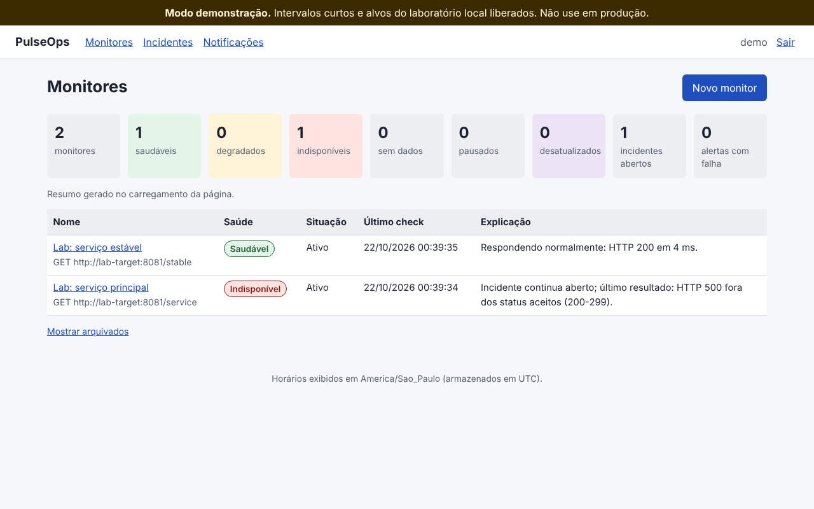

# PulseOps

Monitoramento de APIs HTTP que explica cada mudança de estado. O PulseOps verifica
endpoints periodicamente, abre e encerra incidentes por regras explícitas
(N falhas seguidas abrem, M sucessos seguidos encerram), guarda o motivo de cada
decisão e entrega alertas por webhook sem travar as verificações.

Projeto pessoal de estudo, construído em Python com FastAPI, PostgreSQL e um
worker assíncrono separado.



*Captura real do painel durante o laboratório de falhas: o serviço principal está
com incidente aberto depois de três respostas HTTP 500 seguidas.*

## Problema e cenário (fictício)

> **Cenário fictício**, usado como base de requisitos: uma pequena equipe mantém
> APIs usadas por uma aplicação e descobre problemas quando alguém reclama. Ela
> precisa acompanhar disponibilidade e lentidão, consultar evidências dos
> incidentes e receber alertas sem ser inundada por notificações repetidas.

Ferramentas como Uptime Kuma, Gatus e Healthchecks já resolvem monitoramento (a
comparação está em [`docs/pesquisa-de-mercado.md`](docs/pesquisa-de-mercado.md)).
O PulseOps não é uma ideia nova. O foco dele é um escopo pequeno resolvido por
inteiro: a regra de incidentes, o histórico, os alertas confiáveis e um laboratório
que reproduz as falhas.

## Funcionalidades implementadas

- **Monitores HTTP/HTTPS** com intervalo, timeout, status aceitos (`200-299,301`),
  limite de latência e limiares de falha e de recuperação. Dá para pausar, retomar,
  verificar agora e arquivar sem apagar o histórico.
- **Classificação de cada check**: saudável, lento, status inesperado, timeout,
  erro de conexão ou DNS, erro TLS, destino bloqueado ou erro interno do próprio
  PulseOps (que não conta como falha do alvo).
- **Incidentes com regra explícita.** A lentidão deixa o monitor "degradado" sem
  abrir incidente. O incidente registra a primeira falha, a confirmação, a
  recuperação e os limiares vigentes na abertura. O banco impede dois incidentes
  abertos para o mesmo monitor.
- **Explicação de cada mudança**, por exemplo: "Falha 1 de 3 necessárias para abrir
  incidente: sem resposta em 2 s." ou "Recuperado após 2 sucessos consecutivos".
- **Alertas por webhook com outbox.** O evento é gravado na mesma transação que
  muda o incidente. Um entregador separado envia com timeout, retentativas com
  backoff e teto, e registra cada tentativa. A entrega é "pelo menos uma vez", com
  `X-PulseOps-Event-Id` para o receptor deduplicar.
- **Histórico e métricas**: checks paginados por cursor, filtros por período e
  resultado, proporção de checks disponíveis e saudáveis, latência média e p95,
  incidentes e lacunas de cobertura, gráfico de latência em SVG.
- **Painel web** (Jinja2, sem framework de front-end) com estados vazio, sem dados
  e desatualizado. Os horários são exibidos no fuso configurado e armazenados em UTC.
- **Acesso de um operador** com sessão em cookie `HttpOnly`, senha com Argon2id e
  CSRF em formulários e na API.
- **Proteção contra SSRF**: só `http`/`https`, portas permitidas, nada de
  endereços privados, loopback, link-local ou metadados de nuvem, inclusive em
  formas alternativas (`0x7f.1`, `[::ffff:127.0.0.1]`). O nome é resolvido e
  validado no momento da conexão, e a conexão usa o IP validado. Redirecionamentos
  não são seguidos.
- **Saúde do próprio PulseOps**: `/health/live`, `/health/ready`, heartbeat do
  worker e logs JSON com dados sensíveis mascarados.

## Início rápido

Requisitos: Docker com Compose v2 e Git.

```bash
git clone <url-deste-repositorio> pulseops
cd pulseops
cp .env.example .env                 # troque POSTGRES_PASSWORD
docker compose up -d --build --wait  # banco, migrações, API e worker
docker compose run --rm api pulseops create-admin --username amanda
```

Abra <http://127.0.0.1:8000>, entre com o usuário criado e cadastre um monitor.
Fora do laboratório, monitores só podem apontar para endereços públicos, com
intervalo mínimo de 30 s.

Para parar: `docker compose down` (os dados ficam no volume `pgdata`).

## Demonstração de falha e recuperação

```bash
scripts/demo.sh
```

O script sobe o ambiente com o perfil `demo`, que adiciona um alvo e um receptor
de webhooks controláveis, e executa 11 passos. Cada passo imprime o que verifica
e o script termina com código diferente de zero se algo não se confirmar:

1. Ambiente no ar (API pronta, worker ativo).
2. Monitores preparados sem duplicar (pode rodar o script de novo).
3. Checks saudáveis, depois um check lento: monitor degradado, sem incidente.
4. Um timeout: "Falha 1 de 3", ainda sem incidente.
5. Erros HTTP 500: o incidente abre na 3ª falha seguida, com o motivo registrado.
6. Mais falhas não abrem outro incidente.
7. Alvo restaurado: o primeiro sucesso ainda não encerra (o roteiro mostra isso
   quando consegue observar esse momento; a regra é verificada em
   `tests/unit/test_health.py`).
8. O segundo sucesso encerra o incidente e o alerta de recuperação chega.
9. Receptor fora do ar (503) e novo incidente: a entrega fica pendente.
10. Os checks continuam sendo gravados enquanto o alerta espera.
11. Receptor de volta: a retentativa entrega o alerta; um reenvio manual do mesmo
    evento é reconhecido como duplicado.

A senha da operadora `demo` é gerada na primeira execução e fica em
`.demo/admin-password` (fora do Git). A execução leva cerca de 70 s.

## Arquitetura

```
Navegador ──> api (FastAPI: painel + /api/v1) ──┐
                                                ├──> PostgreSQL
              worker (asyncio) ─────────────────┘
                ├── laço de checks ──> APIs monitoradas (transporte com política SSRF)
                ├── laço de entregas ──> webhooks
                └── manutenção: heartbeat, checks interrompidos, retenção
```

- API e worker são processos separados com a mesma imagem. O worker é único,
  garantido por um advisory lock do PostgreSQL.
- Cada check segue três passos: transação curta para reservar, requisição HTTP
  sem transação aberta e transação curta que grava resultado, contadores,
  incidente e alerta juntos.
- O código fica separado em `domain/` (regras puras), `services/` (casos de uso),
  `security/`, `checks/`, `notifications/`, `db/`, `worker/` e `web/`.

Detalhes, diagrama ER e justificativa de cada índice estão em
[`docs/arquitetura.md`](docs/arquitetura.md).

## Regras importantes

| Regra | Comportamento |
|---|---|
| Abertura | `failure_threshold` falhas seguidas (padrão 3) abrem o incidente. O início é a primeira falha e a confirmação é a falha que atingiu o limiar |
| Recuperação | `recovery_threshold` sucessos seguidos (padrão 2). Respostas lentas contam como sucesso para recuperar |
| Lentidão | Status aceito acima do limite de latência = "lento": monitor degradado, sem incidente |
| Erro interno | Falha do próprio PulseOps não altera contadores nem incidentes |
| Pausar ou arquivar | Encerra o incidente aberto como "encerrado pelo operador" (não "recuperado") e zera os contadores |
| Editar a verificação | Zera os contadores. O incidente aberto continua e passa a usar o novo limiar de recuperação |
| Reinício do worker | Contadores e incidente estão no banco. Atraso maior que um intervalo vira lacuna registrada, sem rajada de checks |
| Alertas | Só transições geram eventos (abertura, recuperação, encerramento). Falhas repetidas não geram novos alertas |
| Métricas | Sem dados aparece "N/A", nunca 0% ou 100%. O p95 é nearest-rank, e com menos de 20 amostras é o maior valor |

A lista completa, com códigos usados nos testes, está em
[`docs/requisitos.md`](docs/requisitos.md).

## Testes e comandos

O projeto usa [uv](https://docs.astral.sh/uv/) (Python 3.12).

```bash
uv sync                                  # dependências fixadas em uv.lock
docker run -d --name pulseops-testdb -e POSTGRES_USER=pulseops \
  -e POSTGRES_PASSWORD=pulseops -p 127.0.0.1:5433:5432 postgres:16-alpine
uv run pytest                            # 251 testes; integração com PostgreSQL real
uv run pytest --cov                      # cobertura (metas em docs/estrategia-de-testes.md)
uv run ruff check . && uv run ruff format --check .
uv run mypy                              # modo estrito
uv run python scripts/conferir_referencias.py  # testes citados nos docs existem
scripts/ensaio_carga.sh                  # ensaio de carga local (requer a demo no ar)
```

A suíte não acessa a internet: DNS, transporte HTTP e relógio são substituídos por
dublês nos testes. Cada um dos 25 cenários obrigatórios aponta para o teste que o
verifica em [`docs/matriz-de-rastreabilidade.md`](docs/matriz-de-rastreabilidade.md).
Resultados medidos (cobertura, carga, auditoria de dependências) ficam em
[`docs/evidencias/`](docs/evidencias/).

O CI (GitHub Actions, `.github/workflows/ci.yml`) roda lint, formatação, tipos,
testes com PostgreSQL como serviço, migrações em banco limpo, auditoria de
dependências e build da imagem. É só CI: nada é implantado.

## Decisões e alternativas

As decisões ficam em [`docs/decisoes/`](docs/decisoes/). As principais:

- **API e worker separados**, sem Celery nem Redis: o banco já guarda a fila
  (`next_run_at`, outbox), e um worker é suficiente para o escopo (ADR 0002).
- **Conectar no IP validado** em vez de só validar o DNS antes: evita DNS
  rebinding (ADR 0005).
- **Outbox no PostgreSQL** em vez de enviar o alerta dentro da verificação: um
  webhook lento não atrasa nenhum check (ADR 0007).
- **Painel renderizado no servidor** com Jinja2 e SVG, sem framework JavaScript
  (ADR 0010).
- **mypy** como verificador de tipos, por causa do plugin do Pydantic (ADR 0009).

Os bugs reais encontrados durante o desenvolvimento, com causa e teste de
regressão, estão em [`docs/registro-de-bugs.md`](docs/registro-de-bugs.md).

## Limitações

- **Um operador e um worker.** Não há usuários múltiplos nem escala horizontal.
- **Sem limite de tentativas de login.** Exponha o painel só em rede local, VPN ou
  atrás de um proxy reverso com HTTPS e rate limit.
- **O PulseOps não avisa quando ele mesmo cai.** Use um verificador externo
  apontando para `/health/ready`.
- **Granularidade de cerca de 1 s** no início dos checks (tick do worker).
- **Webhooks sem assinatura HMAC** e **sem headers de autenticação para os alvos**:
  ficam como roadmap, não estão implementados.
- **Proteção SSRF na aplicação**, sem firewall de saída configurado pelo projeto.
  Ela depende de um detalhe interno do HTTPX para injetar o transporte
  ([`docs/modelo-de-ameacas.md`](docs/modelo-de-ameacas.md)).
- O ensaio de carga mediu 200 monitores a cada 10 s em uma máquina de 4 CPUs
  ([`docs/evidencias/ensaio-de-carga.md`](docs/evidencias/ensaio-de-carga.md)).
  Isso não indica capacidade em produção.

## Como este projeto foi feito

Projeto pessoal de Amanda da Mata, estudante de Análise e Desenvolvimento de
Sistemas, desenvolvido a partir de um cenário de requisitos fictício. Não é
trabalho contratado nem experiência em equipe.

A implementação, os testes e a documentação foram produzidos com o Claude Code
(assistente de IA da Anthropic), a partir de uma especificação detalhada escrita
por Amanda. A especificação definiu requisitos, regras de honestidade e critérios
de aceitação. A revisão, o estudo do código e as decisões de publicação são
responsabilidade de Amanda. O material de estudo que acompanha o projeto serve
justamente para esse estudo.

Outros documentos: [operação e solução de problemas](docs/operacao.md),
[estratégia de testes](docs/estrategia-de-testes.md),
[modelo de ameaças](docs/modelo-de-ameacas.md), [progresso](docs/progresso.md).

## Referências e licença

- OWASP Server-Side Request Forgery Prevention Cheat Sheet, base da política de
  destinos.
- FastAPI, SQLAlchemy 2.x, Alembic, HTTPX, Pydantic e Pytest, consultados pela
  documentação e pelas assinaturas das versões fixadas em `uv.lock` (detalhes em
  [`docs/pesquisa-de-mercado.md`](docs/pesquisa-de-mercado.md)).
- Projetos comparados: Uptime Kuma (MIT), Gatus (Apache-2.0) e Healthchecks
  (BSD-3-Clause). Nenhum código deles foi copiado.

Licença MIT, ver [`LICENSE`](LICENSE).
