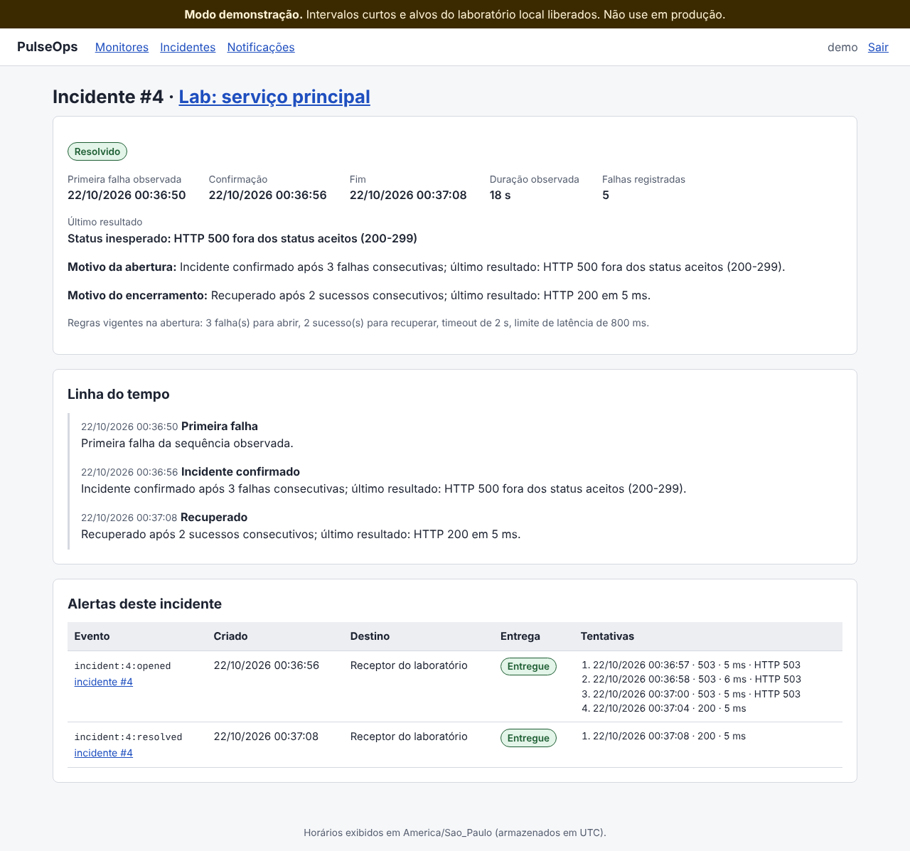
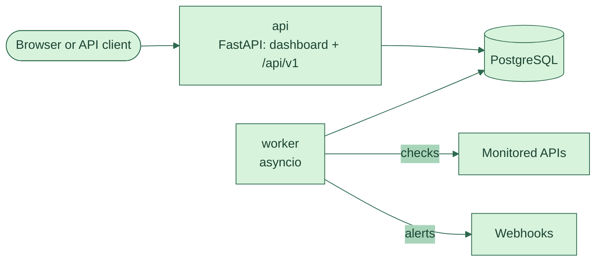

**English** · [Português](README.pt-BR.md)

[](https://github.com/Amandadamata/Pulse-Ops/actions/workflows/ci.yml)


[](LICENSE)

A Python web app that checks HTTP APIs on a schedule and opens an incident when one keeps failing.

## The problem

A small team keeps a few APIs running and finds out something broke when a user complains. Basic uptime checks help, but they raise two new problems. A single slow response can trigger a false alarm, and a long outage can flood the team with the same alert again and again. When an incident is over, nobody remembers exactly when it started or what the error was. *(This is a fictional scenario I wrote as the basis for the requirements.)*

## The solution

PulseOps checks each endpoint at a set interval and records every result. One failure isn't enough to raise an alarm: by default, three failures in a row open an incident, and two successes in a row close it. A slow response marks the API as "degraded" without opening an incident. Every change comes with a reason in plain words, like "Failure 1 of 3 needed to open an incident: no response in 2 s". Alerts go out by webhook from a separate queue, so a slow receiver never delays the checks.

Tools like Uptime Kuma and Gatus already do monitoring, and this isn't meant to replace them. I kept the scope small: one operator, one worker, HTTP checks and webhook alerts.

## Demo

<table>
<tr>
<td width="50%"></td>
<td width="50%"></td>
</tr>
<tr>
<td><sub>Dashboard during the failure lab: the main service has an open incident after three HTTP 500 responses in a row.</sub></td>
<td><sub>An incident from start to finish: first failure, confirmation, recovery, and four tries to deliver the alert while the receiver was returning 503.</sub></td>
</tr>
</table>

Real screenshots from the local lab (the interface is in Portuguese). The lab script `scripts/demo.sh` reproduces this in 11 checked steps, and CI runs it on every push to `main` and every pull request.

## Features

- HTTP/HTTPS monitors with interval, timeout, accepted status codes, latency limit and failure/recovery thresholds. Pause, resume, check now or archive without losing history.
- Each check is classified: healthy, slow, unexpected status, timeout, connection or DNS error, TLS error, blocked target, or an internal PulseOps error (which never counts against the target).
- Incidents opened and closed by explicit thresholds, with a timeline and the reason for each step. The database prevents two open incidents for the same monitor.
- Webhook alerts with retries and backoff. Repeated failures don't create repeated alerts, only state changes do.
- History and metrics: availability, average and p95 latency, coverage gaps, and an SVG latency chart.
- A JSON API under `/api/v1` and a server-rendered dashboard, both behind a login with Argon2id password hashing and CSRF protection.
- Protection against SSRF: monitors can't point to private addresses, loopback or cloud metadata, even in disguised forms like `0x7f.1`.

## What this project shows

| Skill | Where / how it shows up |
|---|---|
| Python, organized in modules | A typed package in `src/pulseops/`, checked by mypy in strict mode. The core rule lives in `domain/` with no database or network, so it can be tested on its own. |
| Business rule tested in isolation | `HealthTracker` in [`src/pulseops/domain/health.py`](src/pulseops/domain/health.py) counts consecutive failures and successes and decides when to open or close an incident. |
| REST API | [`src/pulseops/web/api.py`](src/pulseops/web/api.py): FastAPI routes for monitors, checks, metrics, incidents and alerts, with Pydantic models for input and output. |
| SQL and PostgreSQL | Tables, constraints and partial unique indexes in [`src/pulseops/db/models.py`](src/pulseops/db/models.py), created by an Alembic migration. `FOR UPDATE SKIP LOCKED` in [`src/pulseops/services/processing.py`](src/pulseops/services/processing.py) stops two transactions from taking the same monitor. |
| Automated tests | 251 pytest tests: 133 unit tests and 118 integration tests against a real PostgreSQL. DNS, HTTP and the clock are replaced by test doubles, so the suite never touches the internet. |
| Docker and CI | `compose.yaml` runs the database, migrations, API and worker. [`.github/workflows/ci.yml`](.github/workflows/ci.yml) runs Ruff, mypy, the tests with a coverage gate (90% overall, 95% for domain and security), migrations up and down, a dependency audit and the Docker lab. |
| Requirements and specification | [`docs/especificacao.md`](docs/especificacao.md) and [`docs/requisitos.md`](docs/requisitos.md) define the rules with codes. [`docs/matriz-de-rastreabilidade.md`](docs/matriz-de-rastreabilidade.md) links each required scenario to the test that checks it. |
| Debugging and decisions | 10 real bugs with cause and regression test in [`docs/registro-de-bugs.md`](docs/registro-de-bugs.md), and 11 architecture decision records in [`docs/decisoes/`](docs/decisoes/). |

## How I built it

I wrote the specification: the scenario, the requirements, the incident rules, the honesty rules for the docs and the acceptance criteria. The code, tests and documentation were generated with Claude Code (Anthropic's AI coding assistant) from that specification, one stage at a time. That's why most commits show Claude as the author.

My part after each stage was to review it, run the lab, and decide what to publish. I'm studying the code file by file with the two study guides in [`docs/estudo/`](docs/estudo/). My Python base comes from Harvard's CS50P, where I learned functions, exceptions and unit tests with pytest, and I work on this project in VS Code.

## How it works



There are two processes built from the same image. The **api** serves the dashboard and the JSON API. The **worker** runs the checks in the background. For each check, the worker takes the monitor in a short transaction, makes the HTTP request with no transaction open, and then saves the result, the counters, any incident change and any alert in one more short transaction. Alerts wait in an "outbox" table, and a separate loop delivers them with retries. Because the queue lives in PostgreSQL, the project needs no Redis or Celery.

## Technical decisions

- **I chose to keep the job queue in PostgreSQL instead of adding Redis and Celery,** because one worker is enough for this scope, and it's one less service to run ([ADR 0002](docs/decisoes/0002-api-e-worker-separados.md)).
- **I chose an outbox table instead of sending the alert inside the check,** so a slow webhook never delays a check ([ADR 0007](docs/decisoes/0007-outbox-e-entrega-pelo-menos-uma-vez.md)).
- **I chose not to open an incident for slow responses,** because a slow API is still answering. It shows up as "degraded" instead ([ADR 0004](docs/decisoes/0004-lentidao-nao-abre-incidente.md)).
- **I chose a server-rendered dashboard with Jinja2 and SVG instead of a JavaScript framework,** to keep the project focused on the back end ([ADR 0010](docs/decisoes/0010-dashboard-server-side.md)).

## Running it

You need Docker with Compose v2 and Git.

```bash
git clone https://github.com/Amandadamata/Pulse-Ops.git pulseops
cd pulseops
cp .env.example .env                 # change POSTGRES_PASSWORD
docker compose up -d --build --wait  # database, migrations, API and worker
docker compose run --rm api pulseops create-admin --username amanda
```

Open <http://127.0.0.1:8000>, sign in and add a monitor. To watch the failure lab, run `scripts/demo.sh` (about 70 seconds).

To run the tests, use [uv](https://docs.astral.sh/uv/) and a PostgreSQL container:

```bash
uv sync
docker run -d --name pulseops-testdb -e POSTGRES_USER=pulseops \
  -e POSTGRES_PASSWORD=pulseops -p 127.0.0.1:5433:5432 postgres:16-alpine
uv run pytest
```

## Project structure

```text
src/pulseops/
├── domain/         # pure rules: health, metrics, status codes (no database, no network)
├── services/       # use cases: monitors, incidents, alerts, processing, auth
├── checks/         # the HTTP checker
├── security/       # SSRF policy, passwords, safe transport
├── notifications/  # webhook sender
├── db/             # SQLAlchemy models and session
├── worker/         # background process: checks, deliveries, maintenance
└── web/            # FastAPI app, JSON API, dashboard templates
tests/              # unit/ and integration/ (251 tests)
migrations/         # Alembic
lab/                # fake target and webhook receiver for the demo
docs/               # spec, requirements, ADRs, threat model, bug log, study guides (in Portuguese)
```

## Limits and what's next

- One operator and one worker. No multiple users or horizontal scaling.
- No login rate limit, so the dashboard should only be exposed on a local network or behind a proxy.
- PulseOps can't warn you when it goes down itself. An external checker should watch `/health/ready`.
- Webhooks aren't signed with HMAC yet, and monitors can't send auth headers to their targets.

Next steps on the roadmap: HMAC-signed webhooks and auth headers for monitored APIs.

## Author

**Amanda da Mata** · Back-End developer in training · Java and Python  
[LinkedIn](https://www.linkedin.com/in/amanda-da-mata-492106288) · [amandadamataprofissional@gmail.com](mailto:amandadamataprofissional@gmail.com) · [GitHub](https://github.com/Amandadamata)
