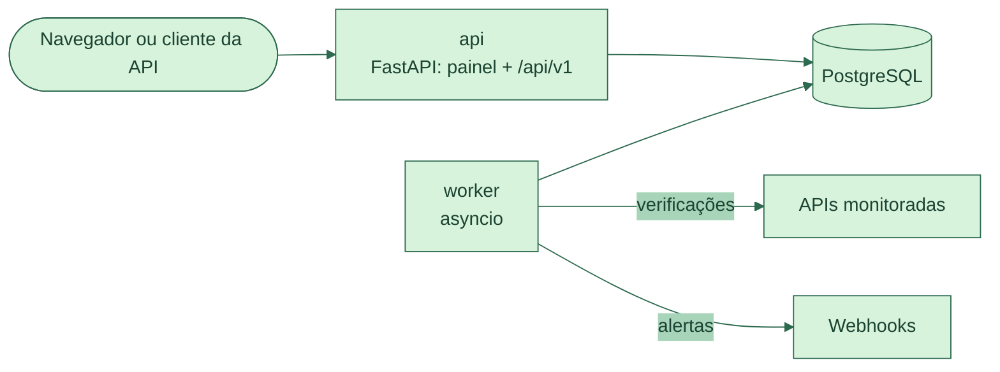

[English](README.md) · **Português**

[](https://github.com/Amandadamata/Pulse-Ops/actions/workflows/ci.yml)


[](LICENSE)

Aplicação web em Python que verifica APIs HTTP periodicamente e abre um incidente quando uma delas continua falhando.

## O problema

Uma equipe pequena mantém algumas APIs no ar e descobre que algo quebrou quando um usuário reclama. Um verificador simples ajuda, mas cria dois problemas novos. Uma única resposta lenta pode gerar alarme falso, e uma queda longa pode inundar a equipe com o mesmo alerta várias vezes. Quando o incidente termina, ninguém lembra direito quando começou nem qual foi o erro. *(É um cenário fictício que escrevi como base para os requisitos.)*

## A solução

O PulseOps verifica cada endpoint num intervalo definido e registra todos os resultados. Uma falha sozinha não basta para dar alarme: por padrão, três falhas seguidas abrem um incidente, e dois sucessos seguidos encerram. Uma resposta lenta deixa a API "degradada" sem abrir incidente. Cada mudança vem com um motivo em linguagem simples, como "Falha 1 de 3 necessárias para abrir incidente: sem resposta em 2 s". Os alertas saem por webhook a partir de uma fila separada, então um receptor lento nunca atrasa as verificações.

Ferramentas como Uptime Kuma e Gatus já fazem monitoramento, e a ideia não é substituí-las. Mantive o escopo pequeno: um operador, um worker, verificações HTTP e alertas por webhook.

## Demonstração

<table>
<tr>
<td width="50%"></td>
<td width="50%"></td>
</tr>
<tr>
<td><sub>Painel durante o laboratório de falhas: o serviço principal está com incidente aberto depois de três respostas HTTP 500 seguidas.</sub></td>
<td><sub>Um incidente do começo ao fim: primeira falha, confirmação, recuperação e quatro tentativas de entregar o alerta enquanto o receptor respondia 503.</sub></td>
</tr>
</table>

Capturas reais do laboratório local. O roteiro `scripts/demo.sh` reproduz tudo isso em 11 passos conferidos, e o CI roda esse roteiro a cada push na `main` e a cada pull request.

## Funcionalidades

- Monitores HTTP/HTTPS com intervalo, timeout, status aceitos, limite de latência e limiares de falha e de recuperação. Dá para pausar, retomar, verificar agora ou arquivar sem perder o histórico.
- Cada verificação é classificada: saudável, lenta, status inesperado, timeout, erro de conexão ou DNS, erro TLS, destino bloqueado ou erro interno do próprio PulseOps (que nunca conta contra o alvo).
- Incidentes abertos e encerrados por limiares explícitos, com linha do tempo e o motivo de cada etapa. O banco impede dois incidentes abertos para o mesmo monitor.
- Alertas por webhook com retentativas e backoff. Falhas repetidas não geram alertas repetidos; só mudanças de estado geram.
- Histórico e métricas: disponibilidade, latência média e p95, lacunas de cobertura e gráfico de latência em SVG.
- API JSON em `/api/v1` e painel renderizado no servidor, os dois protegidos por login com senha em Argon2id e proteção contra CSRF.
- Proteção contra SSRF: monitores não podem apontar para endereços privados, loopback ou metadados de nuvem, nem disfarçados, como `0x7f.1`.

## O que este projeto mostra

| Habilidade | Onde e como aparece |
|---|---|
| Python organizado em módulos | Um pacote tipado em `src/pulseops/`, verificado pelo mypy no modo estrito. A regra central fica em `domain/`, sem banco e sem rede, e pode ser testada sozinha. |
| Regra de negócio testada isoladamente | O `HealthTracker`, em [`src/pulseops/domain/health.py`](src/pulseops/domain/health.py), conta falhas e sucessos seguidos e decide quando abrir ou encerrar um incidente. |
| API REST | [`src/pulseops/web/api.py`](src/pulseops/web/api.py): rotas FastAPI para monitores, verificações, métricas, incidentes e alertas, com modelos Pydantic de entrada e saída. |
| SQL e PostgreSQL | Tabelas, constraints e índices únicos parciais em [`src/pulseops/db/models.py`](src/pulseops/db/models.py), criados por uma migração Alembic. O `FOR UPDATE SKIP LOCKED` em [`src/pulseops/services/processing.py`](src/pulseops/services/processing.py) impede que duas transações peguem o mesmo monitor. |
| Testes automatizados | 251 testes com pytest: 133 de unidade e 118 de integração com PostgreSQL real. DNS, HTTP e relógio são trocados por dublês, então a suíte nunca acessa a internet. |
| Docker e CI | O `compose.yaml` sobe banco, migrações, API e worker. O [`.github/workflows/ci.yml`](.github/workflows/ci.yml) roda Ruff, mypy, os testes com meta de cobertura (90% no geral, 95% em domínio e segurança), migrações para cima e para baixo, auditoria de dependências e o laboratório em Docker. |
| Requisitos e especificação | [`docs/especificacao.md`](docs/especificacao.md) e [`docs/requisitos.md`](docs/requisitos.md) definem as regras com códigos. A [`docs/matriz-de-rastreabilidade.md`](docs/matriz-de-rastreabilidade.md) liga cada cenário obrigatório ao teste que o verifica. |
| Depuração e decisões | 10 bugs reais com causa e teste de regressão em [`docs/registro-de-bugs.md`](docs/registro-de-bugs.md), e 11 registros de decisão de arquitetura em [`docs/decisoes/`](docs/decisoes/). |

## Como eu construí

Eu escrevi a especificação: o cenário, os requisitos, as regras de incidente, as regras de honestidade da documentação e os critérios de aceitação. O código, os testes e a documentação foram gerados com o Claude Code (assistente de programação com IA da Anthropic) a partir dessa especificação, uma etapa por vez. Por isso a maior parte dos commits mostra o Claude como autor.

Depois de cada etapa, minha parte foi revisar, rodar o laboratório e decidir o que publicar. Estou estudando o código arquivo por arquivo com os dois guias de estudo em [`docs/estudo/`](docs/estudo/). Minha base em Python vem do CS50P, de Harvard, onde aprendi funções, exceções e testes de unidade com pytest, e trabalho neste projeto no VS Code.

## Como funciona



São dois processos criados a partir da mesma imagem. A **api** serve o painel e a API JSON. O **worker** faz as verificações em segundo plano. Para cada verificação, o worker reserva o monitor numa transação curta, faz a requisição HTTP sem nenhuma transação aberta e depois grava o resultado, os contadores, a mudança de incidente e o alerta em outra transação curta. Os alertas esperam numa tabela de "outbox", e um laço separado entrega cada um com retentativas. Como a fila fica no PostgreSQL, o projeto não precisa de Redis nem de Celery.

## Decisões técnicas

- **Escolhi manter a fila de tarefas no PostgreSQL em vez de adicionar Redis e Celery,** porque um worker basta para este escopo, e é um serviço a menos para manter ([ADR 0002](docs/decisoes/0002-api-e-worker-separados.md)).
- **Escolhi uma tabela de outbox em vez de enviar o alerta dentro da verificação,** para um webhook lento nunca atrasar uma verificação ([ADR 0007](docs/decisoes/0007-outbox-e-entrega-pelo-menos-uma-vez.md)).
- **Escolhi não abrir incidente por lentidão,** porque uma API lenta ainda está respondendo. Ela aparece como "degradada" ([ADR 0004](docs/decisoes/0004-lentidao-nao-abre-incidente.md)).
- **Escolhi um painel renderizado no servidor, com Jinja2 e SVG, em vez de um framework JavaScript,** para manter o foco do projeto no back-end ([ADR 0010](docs/decisoes/0010-dashboard-server-side.md)).

## Como rodar

Você precisa do Docker com Compose v2 e do Git.

```bash
git clone https://github.com/Amandadamata/Pulse-Ops.git pulseops
cd pulseops
cp .env.example .env                 # troque POSTGRES_PASSWORD
docker compose up -d --build --wait  # banco, migrações, API e worker
docker compose run --rm api pulseops create-admin --username amanda
```

Abra <http://127.0.0.1:8000>, entre e cadastre um monitor. Para ver o laboratório de falhas, rode `scripts/demo.sh` (cerca de 70 segundos).

Para rodar os testes, use o [uv](https://docs.astral.sh/uv/) e um contêiner PostgreSQL:

```bash
uv sync
docker run -d --name pulseops-testdb -e POSTGRES_USER=pulseops \
  -e POSTGRES_PASSWORD=pulseops -p 127.0.0.1:5433:5432 postgres:16-alpine
uv run pytest
```

## Estrutura do projeto

```text
src/pulseops/
├── domain/         # regras puras: saúde, métricas, códigos de status (sem banco, sem rede)
├── services/       # casos de uso: monitores, incidentes, alertas, processamento, login
├── checks/         # o verificador HTTP
├── security/       # política contra SSRF, senhas, transporte seguro
├── notifications/  # envio de webhooks
├── db/             # modelos SQLAlchemy e sessão
├── worker/         # processo em segundo plano: verificações, entregas, manutenção
└── web/            # app FastAPI, API JSON, templates do painel
tests/              # unit/ e integration/ (251 testes)
migrations/         # Alembic
lab/                # alvo falso e receptor de webhooks para a demonstração
docs/               # especificação, requisitos, ADRs, modelo de ameaças, bugs, guias de estudo
```

## Limites e próximos passos

- Um operador e um worker. Não há vários usuários nem escala horizontal.
- Sem limite de tentativas de login, então o painel só deve ficar exposto em rede local ou atrás de um proxy.
- O PulseOps não avisa quando ele mesmo cai. Um verificador externo deve observar `/health/ready`.
- Os webhooks ainda não são assinados com HMAC, e os monitores não enviam cabeçalhos de autenticação aos alvos.

Próximos passos do roadmap: webhooks assinados com HMAC e cabeçalhos de autenticação para as APIs monitoradas.

## Autora

**Amanda da Mata** · Desenvolvedora Back-End em formação · Java e Python  
[LinkedIn](https://www.linkedin.com/in/amanda-da-mata-492106288) · [amandadamataprofissional@gmail.com](mailto:amandadamataprofissional@gmail.com) · [GitHub](https://github.com/Amandadamata)
