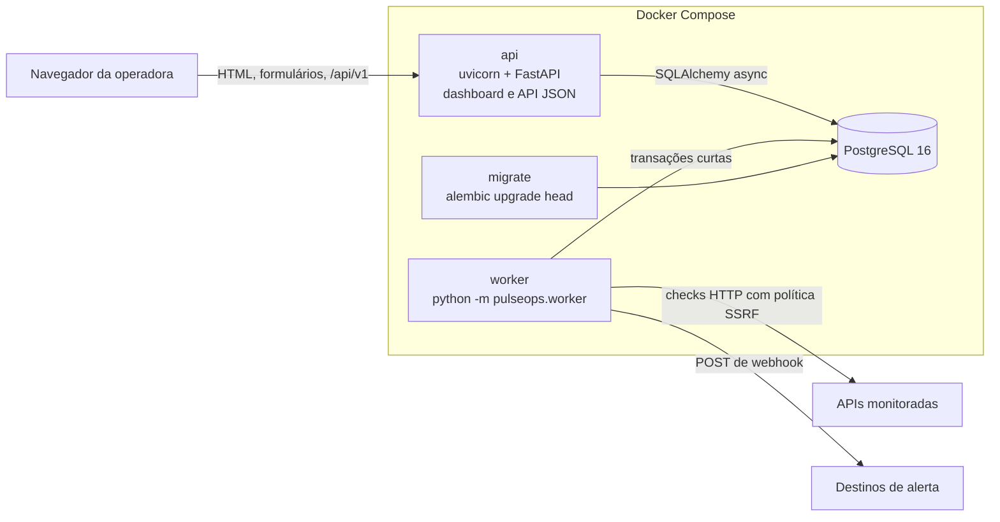
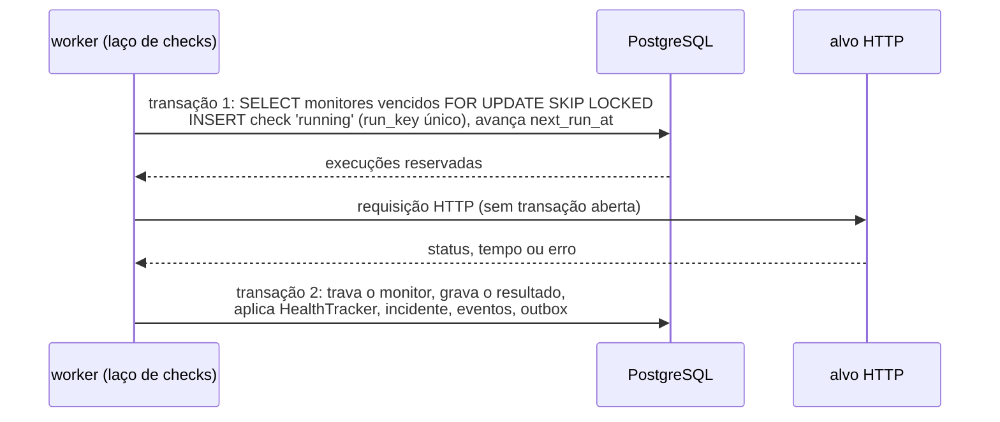
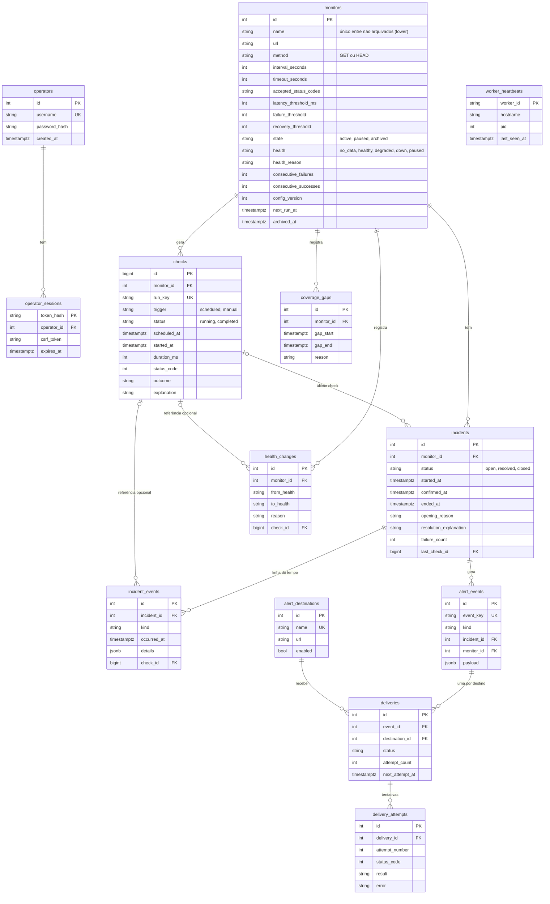

# Arquitetura e modelo de dados

## Processos

- **api** atende o dashboard (Jinja2) e a API JSON em `/api/v1`. Não executa
  nenhum trabalho periódico (ADR 0002). Publica a porta só em `127.0.0.1`.
- **worker** roda três laços `asyncio` independentes: checks, entregas de alertas
  e manutenção (heartbeat, checks abandonados, retenção). Um advisory lock do
  PostgreSQL garante que só um worker fica ativo; um segundo processo sai com erro.
- **migrate** aplica as migrações antes de api e worker subirem.
- **db** não publica porta no Compose padrão.

A mesma imagem atende api, worker, migrate e, no perfil `demo`, o laboratório.

## Ciclo de uma verificação

1. **Reserva** (`services/processing.py::claim_due_runs`): transação curta. O
   índice único parcial `uq_checks_one_running_per_monitor` impede dois checks em
   andamento para o mesmo monitor; `run_key = monitor_id:scheduled_at` é único e
   torna o reprocessamento da mesma execução inofensivo.
2. **Requisição** (`checks/checker.py::HttpChecker`): nenhuma transação aberta. O
   cliente HTTPX usa `GuardedNetworkBackend`, que resolve o nome, valida todos os
   IPs e conecta no IP validado (ADR 0005).
3. **Gravação** (`record_result`): uma transação grava resultado, contadores,
   saúde, mudança de estado, incidente, eventos da linha do tempo, evento de alerta
   e entregas. Ou tudo, ou nada. Se o monitor foi pausado, editado ou arquivado
   durante a requisição (`config_version` diferente), o resultado entra no
   histórico sem efeito no domínio.

Se o processo morrer entre 1 e 3, o check fica `running`. A manutenção o marca
como `internal_error` depois de `timeout + 30 s`; erro interno não conta como
falha do alvo.

**Retomada sem avalanche:** se um monitor está atrasado mais de um intervalo, a
próxima execução é agendada para agora e o período perdido vira uma linha em
`coverage_gaps`, exibida como lacuna nas métricas.

**Vazão:** o laço reserva até `worker_concurrency` execuções. Se preencheu todas
as vagas, volta assim que uma vaga abre; se não havia mais nada vencido, espera o
tick de 1 s (bug B8 e `docs/evidencias/ensaio-de-carga.md`).

## Organização do código

| Pasta | Responsabilidade |
|---|---|
| `domain/` | Regras puras, sem banco nem HTTP: `HealthTracker` (RF03), validação de configuração, códigos de status, fórmulas de métricas |
| `security/` | Política de destinos (SSRF), transporte protegido, hash de senha |
| `checks/` | Cliente de verificação (`Checker` Protocol e `HttpChecker`) |
| `notifications/` | Envio de webhook (`Notifier` Protocol e `WebhookNotifier`) |
| `services/` | Casos de uso que combinam domínio e persistência (monitores, processamento, incidentes, alertas, autenticação, consultas) |
| `db/` | Modelos SQLAlchemy 2.x e sessão |
| `worker/` | Laços do worker e ponto de entrada com o advisory lock |
| `web/` | Rotas da API e das páginas, schemas Pydantic, templates e estáticos |
| `lab/` (raiz) | Alvo e receptor controláveis do laboratório |

**Onde há classes e por quê.** `HealthTracker` encapsula a regra de transição e
recebe `Thresholds` por composição; `HttpChecker`, `WebhookNotifier` e
`SystemClock` implementam `Protocol`s (`Checker`, `Notifier`, `Clock`), o que
permite trocar transporte, notificador e relógio nos testes (`ScriptedTarget`,
`RecordingNotifier`, `FakeClock`). `Worker` guarda o estado dos laços (tarefas em
andamento, última retenção).

**Onde funções simples bastaram.** Casos de uso em `services/` são funções que
recebem a sessão: não guardam estado entre chamadas, e uma classe só repassaria
argumentos. O mesmo vale para `backoff_delay`, `nearest_rank` e `parse_status_codes`.

## Modelo de dados

Todas as datas são `timestamptz` e gravadas em UTC; a interface converte para
`PULSEOPS_DISPLAY_TIMEZONE`.

### Restrições que o banco garante

| Restrição | O que impede |
|---|---|
| `uq_incidents_one_open_per_monitor` (único parcial, `status = 'open'`) | Dois incidentes abertos para o mesmo monitor (CB2) |
| `uq_checks_one_running_per_monitor` (único parcial, `status = 'running'`) | Checks sobrepostos, inclusive "verificar agora" (CB3) |
| `checks.run_key` único | Gravar duas vezes a mesma execução agendada (CB1) |
| `uq_monitors_active_name` (único parcial em `lower(name)`) | Dois monitores ativos ou pausados com o mesmo nome |
| `alert_events.event_key` único (`incident:{id}:{opened,resolved,closed}`) | Evento de alerta duplicado para a mesma transição |
| `uq_deliveries_event_destination` | Duas entregas do mesmo evento para o mesmo destino |
| `uq_delivery_attempts_number` | Duas tentativas com o mesmo número |
| CHECKs de faixa em `monitors` (intervalo, timeout < intervalo, limiares, latência) | Configuração inválida mesmo que a validação da aplicação falhe |
| `(status = 'open') = (ended_at IS NULL)` em `incidents` | Incidente aberto com fim, ou encerrado sem fim |
| `(state = 'archived') = (archived_at IS NOT NULL)` | Arquivamento sem data |
| FKs `ON DELETE RESTRICT` para monitores e incidentes | Apagar monitor ou incidente com histórico (arquivar é o caminho) |
| FKs `ON DELETE SET NULL` para `check_id` | A retenção apaga checks sem perder incidentes, eventos e mudanças de estado |

### Índices e a consulta que cada um atende

| Índice | Consulta |
|---|---|
| `ix_monitors_due` (`next_run_at`, parcial `state = 'active'`) | Reserva do worker: monitores ativos vencidos |
| `ix_checks_monitor_history` (`monitor_id, started_at, id`) | Histórico paginado por cursor e janelas de métricas por monitor |
| `ix_checks_started_at` | Retenção: apagar checks mais antigos que N dias |
| `ix_incidents_confirmed` (`confirmed_at, id`) | Lista geral de incidentes, mais recentes primeiro |
| `ix_incidents_monitor` (`monitor_id, confirmed_at`) | Incidentes de um monitor e contagem na janela de métricas |
| `ix_incident_events_timeline` (`incident_id, occurred_at, id`) | Linha do tempo de um incidente |
| `ix_health_changes_monitor` (`monitor_id, changed_at, id`) | Mudanças de estado na página do monitor |
| `ix_coverage_gaps_monitor` (`monitor_id, gap_start`) | Lacunas na janela de métricas |
| `ix_alert_events_created`, `ix_alert_events_incident` | Página de notificações e alertas de um incidente |
| `ix_deliveries_due` (`next_attempt_at`, parcial `pending`/`sending`) | Reserva do entregador |
| `ix_*_check` (em `incidents`, `incident_events`, `health_changes`) | `SET NULL` rápido quando a retenção apaga checks |

### Retenção, preservação e arquivamento

- **Checks** são apagados depois de `PULSEOPS_CHECK_RETENTION_DAYS` (30 por padrão),
  uma vez por hora, pela manutenção do worker. Referências a eles viram nulas.
- **Incidentes, eventos, mudanças de estado, lacunas e alertas** não são apagados:
  são a evidência do que aconteceu e continuam legíveis depois da retenção (as
  explicações são texto copiado no momento do fato, não junções com o check).
- **Arquivar** um monitor não apaga nada: fecha um incidente aberto com status
  `closed`, para de agendar e libera o nome para um novo monitor. O histórico
  continua consultável (ADR 0006).
